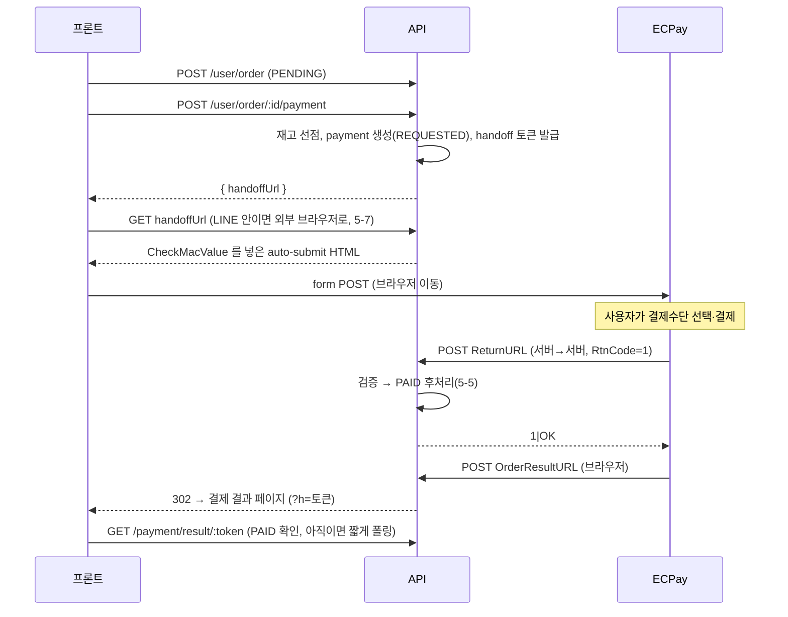
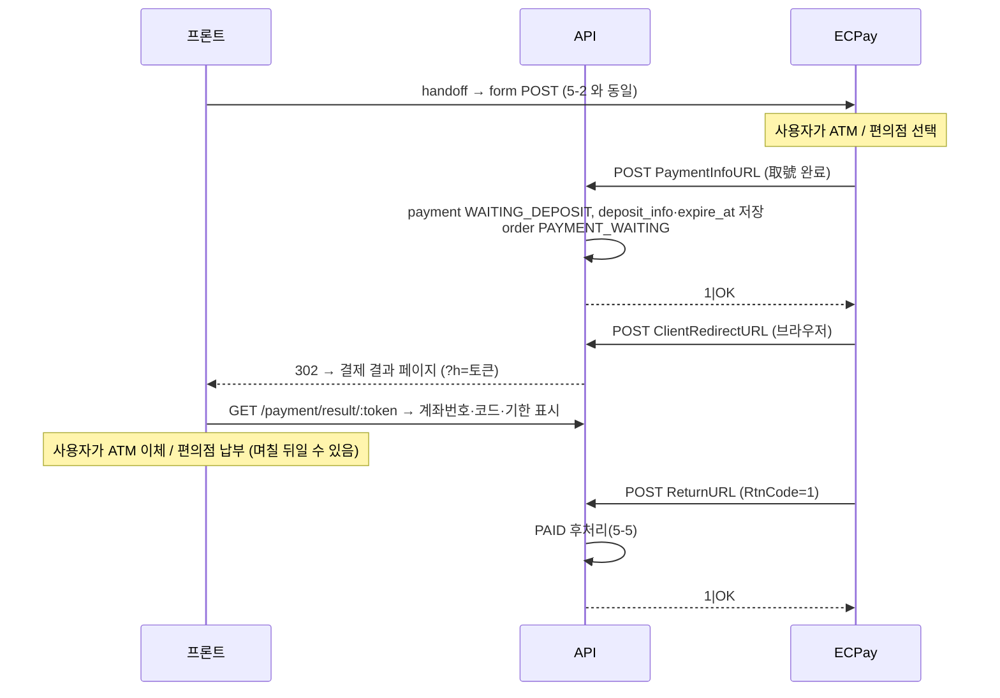
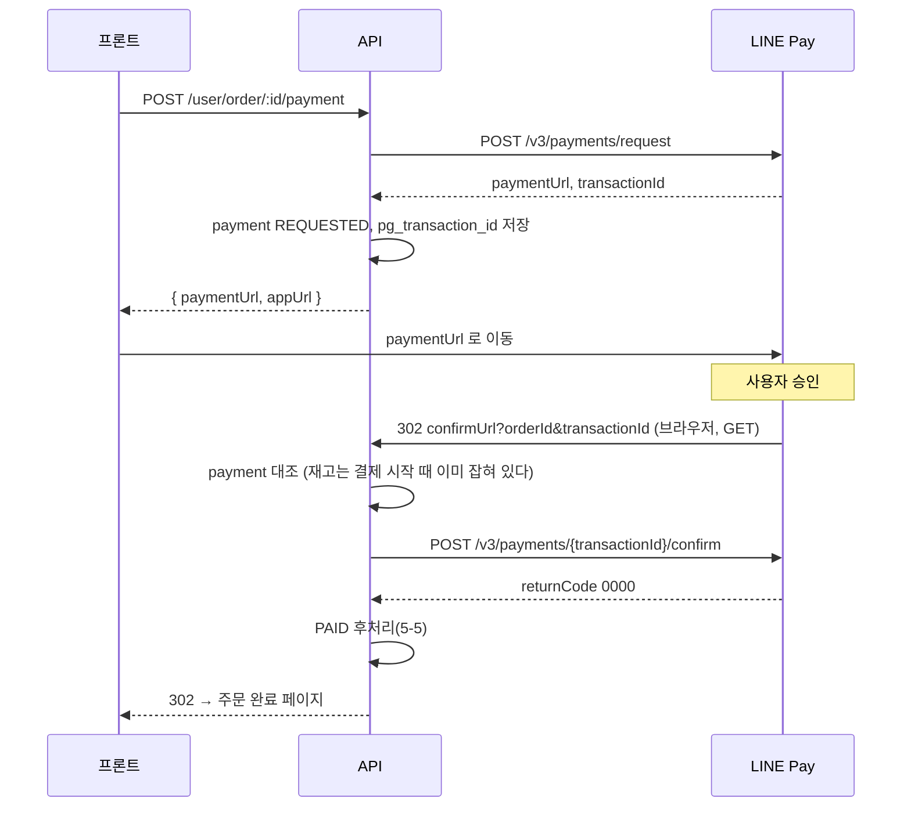

# 대만 결제 연동 계획 — ECPay · LINE Pay

- 작성: 2026-10-26
- 상태: **1차 구현 완료 (2026-10-26)** — 결제 · 재고 선점 · 외부 브라우저 handoff · 전자발표 발행 · 편의점 매장 선택. 아래 "구현 현황" 참고
- 근거: 2026-10-23 슬랙 공유(박우준), 노션 정리본 <https://app.notion.com/p/1dba05a4b146808cab72f970cd924278>
- 외부 API 사실관계는 2026-10-26 ECPay · LINE Pay 공식 문서로 확인했다 (출처는 11장)

> 이 문서에는 **운영 비밀값(HashKey · HashIV · Channel Secret)과 샌드박스 계정 비밀번호를 적지 않는다.**
> 값은 노션과 시크릿 저장소(운영: AWS Secrets Manager, dev: 서버 `.env.dev`)에만 둔다.
> 문서에 적힌 테스트 키는 ECPay 가 **공개한** 값이다.

---

## 0. 한눈에 보기

| 단계 | 내용 | 상태 |
|---|---|---|
| 이전 | 주문을 `PENDING` 으로 만드는 데까지 (`POST /user/order`) | 완료 |
| **1차** | 결제 — LINE Pay, ECPay 통합결제(카드 · ATM · 편의점). 결제 시작 시 재고 선점, 확정 시 장바구니 비우기, LINE 안에서는 외부 브라우저로 handoff | **구현 완료** |
| **1차** | 전자발표(電子發票) — 주문서에서 5가지 방법 입력·확인, 결제 확정 직후 발행, 실패 재시도 | **구현 완료** |
| **1차** | 편의점 픽업 — 전자지도로 매장 선택, 주문서 배송 방법 CVS, 離島 매장 외섬 요금 | **구현 완료** (운송장 생성은 아래) |
| 다음 | 운송장 생성(Express/Create) · 라벨 출력 · 배송 상태 통지 — 관리자 주문 화면과 함께 | 미착수 |
| 범위 밖 | 주문 목록, 취소 · 환불(카드 DoAction · LINE Pay Refund · 발표 작废/折讓), 관리자 주문 화면, 쿠폰 · 포인트 | 다음 스코프 |

### 구현 현황 (2026-10-26)

| 엔드포인트 | 인증 | 용도 |
|---|---|---|
| `POST /user/order` | 회원 | 주문 생성. `shippingType`(HOME/CVS) · `cvsPickup` · `invoice` 추가 |
| `POST /user/order/preview` | 회원 | `shippingType=CVS` + `cvsStoreToken` 이면 매장 기준 배송비 |
| `GET /user/order/:id` | 회원 | `payment`(최근 결제 시도 · 입금 정보) · `invoice` · `shipping.cvsStore` 추가 |
| `POST /user/order/:id/payment` | 회원 | 결제 시작 — 재고 선점, ECPay 는 `handoffUrl`, LINE Pay 는 `paymentUrl`/`appUrl` |
| `GET /payment/ecpay/handoff/:token` | 토큰 | ECPay 결제창 auto-submit 페이지 (30분 · 1회) |
| `GET /payment/result/:token` | 토큰 | 로그인 없이 결제 결과 (개인정보 없음, 7일) |
| `POST /payment/ecpay/return` · `payment-info` · `browser-return` | ECPay | ReturnURL · PaymentInfoURL · OrderResultURL/ClientRedirectURL |
| `GET /payment/linepay/confirm` · `cancel` | LINE Pay | confirmUrl · cancelUrl |
| `GET /user/invoice/mobile-barcode/check` · `love-code/check` · `company/check` | 회원 | 발표 입력값 확인 (하루 캐시) |
| `GET /logistics/cvs/map` | 없음 | ECPay 전자지도 열기 (`chain`, `returnUrl`) |
| `POST /logistics/cvs/map/reply` | ECPay(브라우저) | 고른 매장 수신 → `returnUrl?cvsStoreToken=` |
| `GET /logistics/cvs/store/:token` | 없음 | 고른 매장 조회 (1시간) |

- 배치: 5분마다 입금 기한 만료 · LINE Pay 미확정 회수 · ECPay 이탈 정리 · 24시간 지난 PENDING 주문 취소 · 발표 재발행 (Redis 락, 테스트 환경 제외)
- 테이블: `payment`, `payment_event`, `order_invoice` 신규 / `order.stock_reserved`·`paid_at`, `order_item.cart_item_id`, `order_shipping.shipping_type`·`cvs_*` 추가, `order_shipping` 주소 컬럼 nullable 로 완화 (synchronize 로 자동 반영)
- 테스트: `test/payment.pure.spec.ts`, `test/invoice.pure.spec.ts`, `test/user.payment.spec.ts`, `test/user.order.invoice-cvs.spec.ts`

---

## 1. 받은 정보

### 1-1. ECPay (綠界科技)

결제 · 물류 · 전자발표 · 전자영수증이 한 회원(상점)에 묶여 있고 **네 서비스 모두 같은 키**를 쓴다.

| 항목 | 값 | 비고 |
|---|---|---|
| 상점번호 `MerchantID` (特店編號 / 스토어 코드) | `3496663` | **운영** 상점 |
| `HashKey` | 노션 참조 | 비밀값 |
| `HashIV` | 노션 참조 | 비밀값 |

- 서비스: 金流·MPOS(결제), 電子發票(전자발표), 物流(물류), 電子收據(전자영수증)
  - 상점 관리 화면을 브라우저 자동번역으로 보면 物流가 "기호 논리학"으로 나온다. **물류**다.
- 키에 헷갈리는 글자가 있다(`I`/`l`/`1`, `O`/`0`). 텍스트를 복사해서 넣고, 화면을 보고 다시 타이핑하지 않는다.

**테스트 환경 (ECPay 공개 값)** — 테스트 관리 화면: <https://vendor-stage.ecpay.com.tw/>

| 용도 | MerchantID | HashKey | HashIV | 테스트 관리 화면 로그인 |
|---|---|---|---|---|
| 결제(통합결제 AIO) | `3002607` | `pwFHCqoQZGmho4w6` | `EkRm7iFT261dpevs` | `stagetest3` / `test1234` |
| 전자발표 | `2000132` | `ejCk326UnaZWKisg` | `q9jcZX8Ib9LM8wYk` | `Stagetest1234` / `test1234` |

- 테스트 카드: `4311-9522-2222-2222` (국내), CVV 아무 3자리, 유효기간은 오늘 이후 아무 월/년, **3D 인증번호 `1234` 고정**
- 예전 블로그에 흔한 `2000132 / 5294y06JbISpM5x9 / v77hoKGq4kWxNNIS` 는 현재 결제 테스트 계정이 아니다
- 공개 테스트 상점은 **전 세계 개발자가 같이 쓴다** → 거래번호가 남과 겹칠 수 있다 (4-1)

### 1-2. LINE Pay (대만)

| 항목 | 값 | 비고 |
|---|---|---|
| 회사 등록명 (公司登記名稱) | 首爾映像有限公司 | |
| 브랜드명 (品牌名稱) | Seoul Moment | |
| 사업자번호 (統一編號) | 00148871 | |
| 상점 ID (商店 ID) | `CR.00148871.EC` | |
| 채널 ID (通路 ID) | `2011719693` | API 헤더 `X-LINE-ChannelId` |
| 채널 시크릿 (通路密鑰) | 노션 참조 | 비밀값. 요청 서명에 쓴다 |

- 판매자 포털: <https://pay.line.me/portal/tw/auth/login/id?locale=zh_TW>
- 위 채널은 **운영** 채널이다.
- **샌드박스 계정 발급됨 (2026-10-26 공유)** — 로그인 ID · 비밀번호는 노션에 보관한다.
  - 공식 FAQ 상 정식 가맹점은 **운영 채널 키로도 샌드박스 호스트를 부를 수 있다.**
    그래도 운영 시크릿을 dev 에 퍼뜨리지 않도록 **local · dev 는 샌드박스 계정의 Channel ID · Secret** 을 쓴다.
- **서버 IP 등록은 필요 없다.** 판매자 센터의 "管理付款伺服器 IP" 는 오프라인(POS) API v2 용이다. Online API(v3 · v4)에는 해당하지 않는다.

---

## 2. 현재 코드 상태 (출발점)

| 있는 것 | 위치 |
|---|---|
| `POST /user/order/preview` — 금액 미리보기 (DB 변경 없음) | `apps/api/src/module/user/order/user.order.controller.ts` |
| `POST /user/order` — 주문 `PENDING` 생성. **재고 차감 안 함, 장바구니 안 비움** | `user.order.service.ts` `createOrder` |
| `GET /user/order/:id` — 주문 상세 | 〃 |
| `OrderStatus`: `PENDING` · `PAYMENT_WAITING` · `PAID` · `CANCELED` · `FAILED` (정의만, 전이 로직 없음) | `libs/repository/src/enum/order.enum.ts` |
| `PaymentMethod`: `LINE_PAY` · `ECPAY` — `order.payment_method` 에 저장 | 〃 |
| 주문번호 `SM-yyyyMMdd-000481` (`OrderEntity.buildOrderNumber`, **하이픈 포함**) | `libs/repository/src/entity/order.entity.ts` |
| `@nestjs/schedule` 설치돼 있음 (**아직 아무 데서도 안 씀**) | `package.json` |
| `bodyParser.urlencoded` 전역 적용 — ECPay 콜백(form POST) 파싱 가능 | `apps/api/src/main.ts` |
| TypeORM `synchronize: true` — **prod 포함 전 환경** | `libs/database/src/database.service.ts` |

| 없는 것 | 비고 |
|---|---|
| PG 클라이언트 (`@app/external` 에 ecpay · linepay 없음) | 새로 만든다 |
| 결제 시도 테이블, 콜백 엔드포인트 | 새로 만든다 |
| 주문이 **어느 장바구니 라인에서 왔는지** 기록 | 결제 성공 후 장바구니 비우기에 필요 → 4-2 |
| 스케줄러(만료 처리) | 5-6 |
| 주문 목록 · 취소 · 환불 · 관리자 주문 화면 | 범위 밖 |

---

## 3. 선행 작업 (코드 전에)

- [ ] **보안 정리** — 운영 키가 슬랙 평문, `#잡담` 채널에까지 공유됐다.
  - [ ] 원본 슬랙 메시지 삭제 (공유된 `#잡담` 포함), 노션 한 곳에만 보관
  - [ ] 재발급 검토: ECPay 상점 관리 화면(廠商後台)의 HashKey/HashIV, LINE Pay 판매자 포털의 Channel Secret
- [ ] **테스트 키**
  - [x] ECPay: 공개 테스트 상점 값 확보 (1-1 표)
  - [x] LINE Pay: 샌드박스 계정 발급 (2026-10-26)
  - [ ] LINE Pay: 샌드박스 판매자 센터에 로그인해 Channel ID · Channel Secret 확인 → local · dev env 반영
- [ ] **ECPay 개통 결제수단 확인** — `ChoosePayment=ALL` 이면 상점에 개통된 수단이 결제 페이지에 그대로 다 뜬다.
  카드 · ATM · 편의점 코드(CVS) · 바코드 · Apple Pay 등 무엇이 열려 있는지 상점 관리 화면에서 확인
- [ ] **ECPay 콜백 받을 주소 조건** — ECPay 는 결제 결과를 **서버로 직접 POST** 한다.
  - **HTTPS 443 + 정식 도메인** (IP 주소 X, 포트 지정 X). 문서끼리 "80/443" 과 "443 만" 이 갈리는데 **443 만** 이 안전하다
  - **TLS 1.2**, CDN 주소 말고 원 서버 주소, 외부에서 접근 가능해야 함
  - 방화벽 · WAF 가 있으면 `postgate.ecpay.com.tw`(테스트: `postgate-stage.ecpay.com.tw`)를 **도메인으로** 허용한다. ECPay IP 는 고정이 아니다
  - 로컬 개발: ngrok 같은 HTTPS 터널, 또는 dev 서버에 올려서 테스트
- [ ] **8장 결정 사항** 확정

---

## 4. 데이터 모델

### 4-1. `payment` 테이블 (신규) — 주문 1 : 결제 시도 N

결제 시도를 주문과 분리한다.

- ECPay `MerchantTradeNo` 는 **실패한 시도라도 재사용할 수 없다** ("均為唯一值，不可重複使用"). 결제창에서 이탈한 뒤 다시 결제하려면 새 번호가 필요하다.
- LINE Pay `orderId` 도 중복이면 `1172` 로 거절된다.
- 콜백 원문 · PG 거래번호를 남겨야 분쟁 · 대사(정산 대조)를 할 수 있다.

| 컬럼 | 타입 | 설명 |
|---|---|---|
| `id` | int PK | |
| `order_id` | int | `order.id` |
| `method` | enum `PaymentMethod` | `LINE_PAY` / `ECPAY` |
| `status` | enum `PaymentStatus` | 아래 표 |
| `merchant_trade_no` | varchar(20) unique | 우리 쪽 거래번호. ECPay `MerchantTradeNo` · LINE Pay `orderId` 로 같이 쓴다. **영숫자만, 20자 이하** (ECPay 제약. LINE Pay 는 100자) |
| `amount` | int | 요청 금액(TWD 정수). 콜백 금액과 반드시 대조 |
| `pg_transaction_id` | varchar(64) nullable | ECPay `TradeNo` / LINE Pay `transactionId`. **LINE Pay 는 19자리라 숫자 컬럼 금지** |
| `pg_payment_type` | varchar nullable | ECPay `PaymentType` (예: `Credit_CreditCard`, `ATM_LAND`, `CVS_CVS`) |
| `deposit_info` | jsonb nullable | ATM 가상계좌(은행코드 · 계좌) / 편의점 코드 · 바코드 |
| `expire_at` | timestamptz nullable | 입금 기한 (ATM · 편의점) |
| `paid_at` | timestamptz nullable | |
| `failure_code` / `failure_message` | varchar nullable | PG 응답 코드 · 메시지 |

`PaymentStatus`

| 값 | 의미 |
|---|---|
| `READY` | 행만 만들고 PG 요청 전 (요청 실패 시 여기서 `FAILED`) |
| `REQUESTED` | PG 결제창으로 넘김. 사용자가 결제 중 |
| `WAITING_DEPOSIT` | ECPay ATM · 편의점 번호 발급(取號) 완료, 입금 대기 |
| `PAID` | 결제 확정 |
| `FAILED` | PG 실패 응답 |
| `CANCELED` | 사용자가 결제창에서 취소 |
| `EXPIRED` | 입금 기한 경과 / 승인 후 확정 안 됨 |

**`merchant_trade_no` 만드는 법** — 주문번호 `SM-20260903-000481` 은 하이픈이 있어 그대로 못 쓴다.

- 운영: `SM` + `payment.id` 12자리 0패딩 → 14자 (예: `SM000000001234`). id 기반이라 충돌이 없다.
- local · dev · test: 공개 테스트 상점은 남과 같이 쓰므로 번호가 겹친다.
  환경 접두사 + epoch초 + `payment.id` 끝 4자리처럼 시간을 섞는다 (20자 이하 유지).
- 접두사 규칙은 config(`PAYMENT_TRADE_NO_PREFIX` 등)로 환경별로 나눈다.

**`payment_event` 테이블 (권장)** — 콜백 · PG API 응답을 append-only 로 쌓는다.
(`payment_id`, `source`(`ECPAY_RETURN` / `ECPAY_PAYMENT_INFO` / `LINEPAY_CONFIRM` …), `payload` jsonb, `create_date`).
재전송 · 중복 수신 · 금액 불일치를 나중에 추적할 수 있다. HashKey 등 비밀값은 payload 에 넣지 않는다.

### 4-2. 기존 테이블 변경

| 테이블 | 변경 | 이유 |
|---|---|---|
| `order` | `paid_at` timestamptz nullable 추가 | |
| `order` | `stock_reserved` boolean default false 추가 | 이 주문이 재고를 잡고 있는지. 선점 · 복구를 **멱등**하게 하려고 둔다 (5-5) |
| `order_item` | `cart_item_id` int nullable 추가 (FK 없음) | 결제 성공 시 **주문에 쓴 장바구니 라인만** 지운다. "구매하기"(직접 주문)는 `null` 이라 장바구니를 안 건드린다. `loadCartLines` 에서 이미 `cartItem.id` 를 갖고 있다 |

`synchronize: true` 가 prod 까지 켜져 있어 배포하면 바로 반영된다. **새 테이블 · nullable 컬럼 추가만** 하고, 기존 컬럼 rename · enum 값 삭제는 하지 않는다.

### 4-3. 상태 전이

```
              ECPay ATM·편의점 取號
  PENDING ───────────────────────────▶ PAYMENT_WAITING
     │                                     │
     │ 카드·LINE Pay 결제 확정              │ 입금 확인 (ECPay ReturnURL)
     ▼                                     ▼
    PAID ◀─────────────────────────────────┘

  PENDING          ── N시간 결제 없음 ──▶ CANCELED   (배치)
  PAYMENT_WAITING  ── 입금 기한 경과  ──▶ CANCELED   (배치)
  PAID             ── 환불           ──▶ CANCELED   (다음 스코프)
```

- **결제 시도가 실패 · 취소돼도 주문은 `PENDING` 그대로** 둔다 → 같은 주문으로 다시 결제할 수 있다 (새 `payment` 행).
- 주문 `FAILED` 는 "PG 승인은 났지만 후처리 실패로 환불한 주문" 처럼 재시도 불가한 경우에만 쓴다 (결정 8-2).
- 재고는 **결제 시작 때 잡고**, `PAID` 면 그대로 확정, 시도가 끝나거나(실패 · 취소 · 만료) 주문이 `CANCELED` 되면 돌려준다 (5-5).

---

## 5. 결제 흐름

### 5-1. 엔드포인트

| 메서드 · 경로 | 인증 | 호출 주체 | 역할 |
|---|---|---|---|
| `POST /user/order/:id/payment` | `UserOneTimeTokenGuard` | 프론트 | 결제 시작. **재고 선점** 후 `payment` 생성, PG 진입 정보를 돌려준다 |
| `GET /user/order/:id` (기존) | 〃 | 프론트 | 응답에 결제 상태 · 입금 정보(ATM 계좌 · 편의점 코드 · 기한) 추가 |
| `GET /payment/ecpay/handoff/:token` | 없음 (일회용 토큰) | 브라우저 | ECPay 결제창으로 auto-submit 하는 HTML 을 돌려준다. LINE 안에서 외부 브라우저로 넘길 때 쓴다 (5-7) |
| `GET /payment/result/:token` | 없음 (토큰) | 외부 브라우저의 결과 페이지 | 로그인 없이 볼 수 있는 최소 결제 상태 (주문번호 · 상태 · 입금 정보 · 기한). 개인정보 없음 |
| `POST /payment/ecpay/return` | 없음 (CheckMacValue 검증) | ECPay 서버 | `ReturnURL`. **결제 확정의 유일한 근거**. `1\|OK` 응답 |
| `POST /payment/ecpay/payment-info` | 〃 | ECPay 서버 | `PaymentInfoURL`. ATM · 편의점 번호 발급 통지 → `PAYMENT_WAITING`. `1\|OK` 응답 |
| `POST /payment/ecpay/browser-return` | 〃 | 브라우저 | `OrderResultURL`(카드 등) · `ClientRedirectURL`(ATM · 편의점 取號 후) 겸용. **상태는 바꾸지 않고** 프론트 결제 결과 페이지(`?h=토큰`)로 302 |
| `GET /payment/linepay/confirm` | 없음 (DB 의 payment 와 대조) | 브라우저 | `confirmUrl`. 서버가 Confirm API 호출 → 완료/실패 페이지로 302 |
| `GET /payment/linepay/cancel` | 〃 | 브라우저 | `cancelUrl`. `payment` → `CANCELED`, 302 |

- `OrderResultURL` 은 `ReturnURL` 과 **같은 주소로 두면 안 된다** (ECPay 문서). 그래서 경로를 나눴다.
- `OrderResultURL` 은 ATM · 편의점 · 바코드 · 銀聯카드에서는 동작하지 않는다 → 이 수단들은 `ClientRedirectURL` 로 브라우저를 받는다.

`POST /user/order/:id/payment` 검증

1. 본인 주문인지 (`findDetailByIdAndUserId`) — 아니면 404
2. 주문이 `PENDING` 인지 — `PAID` · `PAYMENT_WAITING` · `CANCELED` 면 409
3. 진행 중(`REQUESTED`)인 이전 시도가 있으면 `CANCELED` 로 정리하고 새로 만든다
4. 금액은 **`order.total_amount` 만** 쓴다 (프론트가 보낸 금액을 믿지 않는다)
5. **재고 선점** — `order.stock_reserved` 가 false 면 주문 라인 전부를 조건부 UPDATE 로 차감하고 true 로 바꾼다.
   하나라도 모자라면 전부 롤백하고 409 — PG 로 넘기지 않으니 돈이 빠질 일이 없다. 이미 true 면(재시도) 건너뛴다.

응답

```jsonc
// LINE_PAY
{ "method": "LINE_PAY", "paymentUrl": "https://...", "appUrl": "line://..." }

// ECPAY — 브라우저를 handoffUrl 로 보내면 서버가 그린 페이지가 ECPay 로 auto-submit 한다
{ "method": "ECPAY", "handoffUrl": "{API 공개 URL}/payment/ecpay/handoff/{token}" }
```

ECPay 는 결제창 진입이 **form POST** 라서 URL 하나로 열 수가 없다. 그런데 LINE 안에서 외부 브라우저로 넘기는 방법(5-7)은 전부 **GET URL 을 여는 것**이다.
그래서 서버가 ECPay form 을 그린 HTML 페이지를 GET 으로 주고, 프론트는 상황과 상관없이 그 URL 만 연다. 프론트 경로가 하나로 줄어든다.

### 5-2. ECPay 통합결제 (카드)



- `ReturnURL` 과 `OrderResultURL` 은 **도착 순서가 보장되지 않는다.** 완료 페이지가 먼저 뜨고 `PAID` 가 나중에 올 수 있으니 프론트는 짧게 폴링한다.
- **iOS 의 LINE · Facebook 인앱 브라우저에서는 ECPay 결제가 실패할 수 있다** (ECPay 문서 경고). LINE 로그인(LIFF)을 쓰는 서비스라 해당 사용자가 많다 → **외부 브라우저로 넘긴다** (5-7, 결정됨).

요청 파라미터

| 파라미터 | 값 |
|---|---|
| `MerchantID` | config |
| `MerchantTradeNo` | `payment.merchant_trade_no` (영숫자 20자 이하) |
| `MerchantTradeDate` | `yyyy/MM/dd HH:mm:ss` — **대만 시간(UTC+8)으로 포맷**. 서버(ECS)는 UTC 다 |
| `PaymentType` | `aio` |
| `TotalAmount` | `order.total_amount` (정수 TWD) |
| `TradeDesc` | 예: `Seoul Moment Order` (200자 이하) |
| `ItemName` | `상품명 x 수량` 을 `#` 로 연결. **400자 이하로 우리가 직접 자른다** — 넘기면 ECPay 가 잘라서 CheckMacValue 가 틀어진다. 넘치면 `...외 N건` |
| `ChoosePayment` | `ALL` (결정 8-4) |
| `EncryptType` | `1` (SHA256 고정) |
| `ReturnURL` | `{API 공개 URL}/payment/ecpay/return` |
| `OrderResultURL` | `{API 공개 URL}/payment/ecpay/browser-return` |
| `ClientRedirectURL` | 〃 (ATM · 편의점 取號 후 브라우저) |
| `PaymentInfoURL` | `{API 공개 URL}/payment/ecpay/payment-info` |
| `ClientBackURL` | 프론트 주문 상세 (결제창 "돌아가기"). `OrderResultURL` 이 있으면 그쪽이 우선 |
| `ExpireDate` | ATM 입금 기한, **일 단위** 1–60 (기본 3, 마지막 날 23:59 마감) |
| `StoreExpireDate` | 편의점 코드는 **분 단위** (기본 10080 = 7일, 최대 43200 = 30일), 바코드는 **일 단위** (1–30, 기본 7). 같은 이름인데 단위가 다르다 |
| `IgnorePayment` | 숨길 결제수단, `#` 로 구분 (결정 8-4) |
| `Language` | `Accept-Language` 매핑: ko → `KOR`, en → `ENG`, zh → 생략(번체 기본) |
| `CustomField1~4` | 필요하면 (각 50자) |
| `CheckMacValue` | 아래 |

**CheckMacValue**

1. `CheckMacValue` 를 뺀 파라미터를 키 이름 A→Z 로 정렬
2. `key=value` 를 `&` 로 연결
3. 앞에 `HashKey=...&`, 뒤에 `&HashIV=...` 를 붙임
4. URL 인코딩 → 소문자
5. SHA256 → 대문자

4번 인코딩은 .NET `HttpUtility.UrlEncode` 결과와 같아야 한다.

| 규칙 | 내용 |
|---|---|
| 인코딩하지 않는 문자 | `-` `_` `.` `!` `*` `(` `)` |
| 공백 | `+` |
| 인코딩하는 문자 (Node `encodeURIComponent` 가 안 하는 것) | `~` → `%7e`, `'` → `%27` |
| PHP `urlencode` 기준 되돌림 | `%2d→-` `%5f→_` `%2e→.` `%21→!` `%2a→*` `%28→(` `%29→)` |

Node 에서는 `encodeURIComponent` 후 `%20`→`+`, `~`→`%7e`, `'`→`%27` 로 바꾸고 소문자화한다.

- 순수 함수(`ecpay.check-mac.ts`)로 떼고, **문서 예제값으로 고정 단위 테스트**를 먼저 만든다. 인코딩 규칙 하나만 틀려도 전부 실패한다.
- 콜백 검증 때도 같은 함수로 계산한다. **받은 필드 전부**(모르는 필드 포함)로 계산해야 맞는다.

**`ReturnURL` 처리 체크리스트**

- [ ] **DTO 로 받지 않는다.** 전역 `ValidationPipe` 가 `forbidNonWhitelisted: true` 라서 ECPay 가 보내는 필드 하나만 DTO 에 없어도 400 → ECPay 는 계속 재전송한다.
  `@Body() body: Record<string, string>` 로 받는다 (메타타입이 `Object` 라 검증을 건너뛴다).
- [ ] CheckMacValue 검증 — 실패하면 상태를 바꾸지 않고 로그만 남긴다 (`1|OK` 를 보내지 않는다)
- [ ] `MerchantTradeNo` 로 `payment` 조회 — 없으면 로그
- [ ] `TradeAmt` == `payment.amount` — 다르면 `PAID` 처리 금지, 알림
- [ ] `RtnCode == 1` 일 때만 결제 성공
- [ ] **`SimulatePaid == 1` 은 모의 결제** — RtnCode 도 1 로 오지만 실제 돈은 없다. 운영에서는 `PAID` 로 만들지 않는다 (테스트 환경에서만 허용)
- [ ] **멱등** — 이미 `PAID` 면 아무것도 안 하고 `1|OK`
- [ ] `payment` 행을 `SELECT ... FOR UPDATE` 로 잠그고 한 트랜잭션에서 처리
- [ ] 응답은 **`text/plain` 으로 정확히 `1|OK`** (`1|ok` · 빈 응답은 실패로 친다). `ResponseDataDto` 로 감싸지 않는다. 예외가 나도 전역 필터가 JSON 을 뱉지 않게 컨트롤러에서 잡는다
- [ ] `payment_event` 에 원문 저장
- 재전송 규칙: `1|OK` 를 못 받으면 **5~15분 간격으로 당일 4번** 다시 보낸다. 서버가 한 시간 넘게 죽어 있으면 통지를 놓칠 수 있다 → 카드 결제는 대사 배치로 메운다 (5-6)

### 5-3. ECPay ATM · 편의점 코드 (입금 대기)



- 번호 발급 통지는 ATM `RtnCode=2`, 편의점 · 바코드 `RtnCode=10100073` 이다. **결제 성공이 아니다.** 여기도 `1|OK` 로 답하고 재전송 규칙은 같다.
- **미입금 만료 통지는 없다** (문서 어디에도 없음). 그리고 `QueryTradeInfo` 문서는 ATM · 편의점 같은 오프라인 결제는 조회하지 말고 통지를 기다리라고 한다.
  → **배치가 우리 `expire_at` 기준으로 만료 처리**한다 (5-6).
- 재고: 결제 시작 때 잡은 재고를 **입금 기한까지 그대로 잡아 둔다** (결정 8-1). 기한이 지나면 배치가 돌려준다.

### 5-4. LINE Pay



**API 버전** — v3 와 v4 가 둘 다 현행이다. v4 는 2025-11 대만 전자결제기관(EPI) 규정 때문에 추가됐고, v3 와 다른 점은 `info.paymentProvider` 와 `options.regPayRequest` 두 가지뿐이다. 문서상 v3 를 계속 써도 되고 이전 기한도 없다 (결정 8-11). 아래 예시는 v3 경로다.

Request API 본문

```jsonc
{
  "amount": 1360,                 // order.total_amount
  "currency": "TWD",
  "orderId": "SM000000001234",    // payment.merchant_trade_no
  "packages": [{
    "id": "1",
    "amount": 1360,               // products 합 = amount 가 되도록
    "products": [
      { "name": "상품명 / IVORY / M", "quantity": 2, "price": 650 },  // unit_discount_price
      { "name": "運費", "quantity": 1, "price": 60 }                    // 배송비를 별도 라인으로
    ]
  }],
  "redirectUrls": {
    "confirmUrl": "{API 공개 URL}/payment/linepay/confirm",   // 500자 이하
    "cancelUrl": "{API 공개 URL}/payment/linepay/cancel"
  }
}
```

주의

- **서명 헤더**: `X-LINE-ChannelId`, `X-LINE-Authorization-Nonce`(UUID v1/v4 또는 timestamp), `X-LINE-Authorization` = Base64(HMAC-SHA256(key=ChannelSecret, ChannelSecret + API 경로 + 요청 본문 + nonce)).
  GET 요청은 본문 자리에 쿼리스트링을 넣는다.
- **`transactionId` 는 19자리** — `JSON.parse` 하면 `Number.MAX_SAFE_INTEGER` 를 넘어 값이 깨진다 (문서가 직접 경고).
  응답을 문자열로 받아 16자리 이상 숫자를 문자열로 바꾼 뒤 파싱하고(문서의 `handleBigInteger()` 예제), DB 에도 문자열로 저장한다. axios 기본 `JSON.parse` 를 쓰면 안 된다.
- **`confirmUrl` 은 GET 으로 오고 `orderId` · `transactionId` 가 자동으로 붙는다.** 우리가 URL 에 미리 넣지 않는다.
- **Confirm API 타임아웃은 40초 이상**으로 잡으라고 문서가 권한다.
- **확정 방식(`confirmUrlType`)**: 기본 `CLIENT` 를 쓴다.
  - `CLIENT` 에는 서버→서버 통지가 없다. 사용자가 승인한 뒤 브라우저를 닫아 `confirmUrl` 에 안 오면 승인만 되고 확정이 안 된다 → 배치가 상태 조회 API 로 회수한다 (5-6).
  - `SERVER` 로 하면 LINE Pay 서버가 `confirmUrl` 을 직접 부르지만, LINE Pay IP(운영 `211.249.40.1–30`, `147.92.220.5–8`)를 우리 쪽에서 허용해야 한다. 1차에서는 쓰지 않는다.
- 승인 후 Confirm 까지의 **제한 시간은 문서에 숫자가 없다.** 만료되면 `0121`(인증 대기 시간 만료) · `1180`(결제 시간 만료)이 온다.
- **Confirm 결과를 모를 때**(타임아웃) 바로 실패 처리하지 말고 상태 조회 API 로 다시 확인한다. 같은 거래를 두 번 확정하거나, 돈은 빠졌는데 실패로 보이는 경우를 막는다.
- **재고는 결제 시작 때 이미 잡혀 있다.** Confirm 이 실패하거나 사용자가 취소(`cancelUrl`)하면 그 자리에서 돌려준다.
  만약 배치가 재고를 돌려준 뒤에 사용자가 늦게 승인했다면, Confirm 전에 다시 잡아 보고 모자라면 Confirm 하지 않는다 → 돈이 빠지지 않는다.
- LINE 안(LIFF)에서도 LINE Pay 는 그대로 열면 된다. 외부 브라우저로 넘기는 건 ECPay 만이다.

### 5-5. 결제 확정 후처리 (공통, 한 트랜잭션)

`PaymentCompletionService` 같은 곳에 한 벌만 두고 ECPay · LINE Pay 가 같이 쓴다.

1. `payment` → `PAID`, `paid_at`, `pg_transaction_id`, `pg_payment_type`
2. `order` → `PAID`, `paid_at`
3. **재고 확정** — 결제 시작 때 잡아 둔 재고(`order.stock_reserved = true`)라면 할 일이 없다.
   잡은 재고가 배치로 풀린 뒤에 결제가 늦게 들어온 경우만 여기서 다시 차감한다.
   - LINE Pay: Confirm 전에 다시 잡으므로 모자라면 Confirm 을 안 한다 (5-4)
   - ECPay: 이미 돈이 빠진 뒤다 → 모자라면 환불 또는 운영자 확인 대상으로 표시 (결정 8-2)

**재고 선점 · 복구 규칙** (결정 8-1)

| 시점 | 동작 |
|---|---|
| 결제 시작 (`POST /user/order/:id/payment`) | `stock_reserved = false` 면 라인 전부 조건부 UPDATE 로 차감 → true. 하나라도 모자라면 전부 롤백, 409 |
| 결제 시도 실패 · 취소 (LINE Pay cancel/confirm 실패, ECPay 실패 통지) | 복구 → false. 주문은 `PENDING` 이라 다시 결제하면 다시 잡는다 |
| 결제창 이탈 (ECPay 는 이탈 신호가 없다) | 배치가 `REQUESTED` 30분 경과 건을 PG 에 확인한 뒤 미결제면 복구 (5-6) |
| ATM · 편의점 입금 대기 | **기한까지 잡아 둔다.** 기한이 지나면 배치가 복구 + 주문 `CANCELED` |
| `PAID` | 그대로 확정 |

- 차감: `UPDATE product_variant SET stock_quantity = stock_quantity - :qty WHERE id = :id AND stock_quantity >= :qty` — 영향 행 0 이면 부족
- 복구: `stock_quantity + :qty`. `stock_reserved` 를 같은 트랜잭션에서 바꿔서 **두 번 차감 · 두 번 복구가 안 되게** 한다
- 상품이 삭제돼 `order_item.product_variant_id` 가 NULL 인 라인은 복구를 건너뛴다
- 지금 `user.order.service.ts` 의 `assertPurchasable` 주석("차감은 결제 확정 단계에서 한다")도 같이 고친다
4. **장바구니 비우기** — `order_item.cart_item_id` 가 있는 라인만 `cartRepositoryService.deleteByIds(userId, ids)`.
   "구매하기" 주문은 지울 게 없다.
5. 트랜잭션 밖(커밋 후):
   - 전자발표 발행 (2차) — 실패해도 결제는 유지, 재시도
   - 결제 완료 알림 (결정 8-10)

### 5-6. 만료 · 회수 배치

`@nestjs/schedule` 의 `ScheduleModule` 을 처음 붙인다.

| 주기 | 대상 | 처리 |
|---|---|---|
| 10분 | `PENDING` 주문 중 생성 후 24시간 지났고 진행 중 결제가 없는 것 | 주문 `CANCELED` (재고 잡고 있으면 복구) |
| 10분 | `WAITING_DEPOSIT` 중 `expire_at` 이 지난 것 | `payment` `EXPIRED`, 재고 복구, 주문 `CANCELED` |
| 5분 | LINE Pay `REQUESTED` 중 10분 넘은 것 | 상태 조회 API `GET /v3/payments/requests/{transactionId}/check` → 아래 표. 30분 넘게 미승인이면 `EXPIRED` + 재고 복구 |
| 10분 | ECPay `REQUESTED` 중 30분 넘은 것 | `QueryTradeInfo` 로 확인 — 결제됐으면 `PAID` 처리(`ReturnURL` 을 놓친 경우), 미결제면 `EXPIRED` + 재고 복구 |

LINE Pay 상태 조회 응답 코드

| 코드 | 의미 | 처리 |
|---|---|---|
| `0000` | 사용자 미승인 | 기다림 (오래되면 `EXPIRED`) |
| `0110` | 승인 완료, Confirm 가능 | 재고 확인 후 Confirm |
| `0121` | 사용자 취소 / 만료 | `CANCELED` / `EXPIRED` |
| `0122` | 실패 | `FAILED` |
| `0123` | 이미 완료 | `PAID` 반영 |

ECPay `QueryTradeInfo` 주의

- 파라미터: `MerchantID`, `MerchantTradeNo`, `TimeStamp`(3분 유효), `CheckMacValue`. `TradeStatus` 0 미결제 / 1 결제됨 / 10200095 미완료
- **카드만** 조회한다 (ATM · 편의점은 조회하지 말라는 게 문서 입장)
- 카드 결제는 **약 10분 뒤에** 조회하라고 권한다
- **너무 자주 부르면 HTTP 403 + 30분 차단** — 주기를 넉넉히, 건별 조회 간격도 둔다

ECS 태스크가 여러 개면 크론이 동시에 돈다 → `@app/cache`(Redis)로 락을 잡는다.

### 5-7. LINE 안에서 ECPay 결제 — 외부 브라우저로 넘기기 (결정 8-12)

ECPay 는 iOS LINE 인앱 브라우저에서 결제가 실패할 수 있다고 경고한다. 그래서 **LINE 안에서 ECPay 를 고르면 외부 브라우저(Safari · Chrome)로 넘긴다.** OS 를 가리지 않고 LINE 안이면 전부 넘긴다(단순하고 안전).

LINE 에서 외부 브라우저를 여는 방법은 두 가지다. 프론트가 LIFF(`@line/liff`)를 쓰므로 둘 다 대비한다.

| 상황 | 방법 | 근거 |
|---|---|---|
| LIFF 브라우저 안 (`liff.isInClient() === true`) | `liff.openWindow({ url, external: true })` | `openExternalBrowser=1` 은 **LIFF 앱에서는 동작하지 않는다** (LINE 문서) |
| LIFF 가 아닌 LINE 인앱 브라우저 (UA 에 `Line/`) | URL 에 `?openExternalBrowser=1` 을 붙여 이동 | LINE URL scheme 문서 |
| 그 밖 (일반 브라우저) | 그냥 이동 | |

```ts
const { handoffUrl } = await api.post(`/user/order/${orderId}/payment`);

if (liff.isInClient()) {
  liff.openWindow({ url: handoffUrl, external: true });
} else if (/\bLine\//i.test(navigator.userAgent)) {
  location.href = `${handoffUrl}?openExternalBrowser=1`;
} else {
  location.href = handoffUrl;
}
```

**왜 handoff 페이지가 필요한가**

1. 외부 브라우저로 넘기는 방법은 둘 다 **GET URL 을 여는 것**뿐이다. ECPay 진입은 form POST 다 → 서버가 form 을 그린 HTML 을 GET 으로 준다.
2. 외부 브라우저에는 **로그인 토큰이 없다** (LINE 안의 저장소와 분리돼 있다) → 인증 대신 **일회용 토큰**으로 연다.

**handoff 토큰**

- 결제 시작 때 발급. Redis(`@app/cache`)에 `token → paymentId` 로 저장, TTL 30분, 32바이트 랜덤
- `GET /payment/ecpay/handoff/:token` — 첫 호출에만 form 을 그린다. **두 번째부터는 그리지 않는다**: 같은 `MerchantTradeNo` 를 ECPay 에 다시 보내면 중복으로 거절된다.
  두 번째 호출이면 "결제창을 이미 열었습니다. LINE 으로 돌아가 다시 시도해 주세요" 페이지를 보여준다. 다시 시도하면 새 `payment` 가 만들어진다.
- 응답 HTML: form + `document.forms[0].submit()` + JS 가 꺼진 경우를 위한 버튼. `Content-Type: text/html`. iframe 에 넣지 않는다
- `GET /payment/result/:token` — 로그인 없이 보는 결과용. 주문번호 · 결제 상태 · (ATM · 편의점이면) 입금 계좌 · 코드 · 기한만 준다. 이름 · 주소 · 전화번호는 주지 않는다

**결제가 끝난 뒤**

- `OrderResultURL` · `ClientRedirectURL` → `POST /payment/ecpay/browser-return` 이 `MerchantTradeNo` 로 payment 를 찾아 handoff 토큰을 붙여 `{STOREFRONT_BASE_URL}/payment/result?h={token}` 로 302
- 외부 브라우저의 결과 페이지: 토큰으로 상태를 보여주고 **"LINE 으로 돌아가기"** 버튼(`https://liff.line.me/{LIFF_ID}/order/{orderId}` 같은 LIFF URL)을 둔다
- LINE 안에 남아 있는 원래 페이지: "외부 브라우저에서 결제 중" 을 띄우고 `GET /user/order/:id` 를 폴링한다(로그인돼 있음) → `PAID` · `PAYMENT_WAITING` 이 되면 그 자리에서 완료 화면으로 바뀐다
- 일반 브라우저 사용자도 같은 경로를 탄다 (결과 페이지가 토큰으로 상태를 읽으므로 로그인 여부와 상관없다)

---

## 6. 코드 구조

```
libs/external/src/ecpay/
  ecpay.module.ts
  ecpay.service.ts        # buildCheckoutForm, verifyCallback, queryTradeInfo
  ecpay.check-mac.ts      # CheckMacValue 순수 함수 (단위 테스트)
  ecpay.dto.ts
libs/external/src/linepay/
  linepay.module.ts
  linepay.service.ts      # request, confirm, checkStatus, refund
  linepay.signature.ts    # HMAC 서명 순수 함수
  linepay.dto.ts

libs/repository/src/entity/payment.entity.ts
libs/repository/src/entity/payment-event.entity.ts
libs/repository/src/enum/payment.enum.ts                # PaymentStatus
libs/repository/src/service/payment.repository.service.ts

apps/api/src/module/user/payment/                       # POST /user/order/:id/payment
  user.payment.controller.ts / .service.ts / .dto.ts / .module.ts
apps/api/src/module/payment/                            # PG 콜백 · handoff (가드 없음)
  ecpay.callback.controller.ts
  linepay.callback.controller.ts
  payment-handoff.controller.ts / .service.ts           # 5-7 handoff 페이지 · 토큰 상태 조회
  payment-completion.service.ts                         # 5-5 공통 후처리
  stock-reservation.service.ts                          # 5-5 재고 선점 · 복구
  payment.scheduler.ts                                  # 5-6
```

- 새 모듈은 `apps/api/src/main.ts` Swagger 모듈 목록에 넣는다. 콜백 컨트롤러는 Swagger 에서 빼도 된다.
- 응답 래핑 · DTO 응답 규칙(`static from`), `ServiceError` 사용은 기존 컨벤션을 따른다.

### 6-1. 환경변수

`libs/config/src/configImpl.ts` + `env/local.ts` · `dev.ts` · `test.ts` · `prod.ts` 네 곳에 추가한다.

| 키 | local · dev · test | prod |
|---|---|---|
| `ECPAY_MERCHANT_ID` | `3002607` (공개 테스트) | `3496663` |
| `ECPAY_HASH_KEY` | `pwFHCqoQZGmho4w6` (공개 테스트) | 노션 값 |
| `ECPAY_HASH_IV` | `EkRm7iFT261dpevs` (공개 테스트) | 노션 값 |
| `ECPAY_PAYMENT_URL` | `https://payment-stage.ecpay.com.tw` | `https://payment.ecpay.com.tw` |
| `LINE_PAY_CHANNEL_ID` | 샌드박스 계정의 채널 ID | `2011719693` |
| `LINE_PAY_CHANNEL_SECRET` | 샌드박스 계정의 Channel Secret | 노션 값 |
| `LINE_PAY_API_URL` | `https://sandbox-api-pay.line.me` | `https://api-pay.line.me` |
| `PAYMENT_CALLBACK_BASE_URL` | dev API 공개 URL / ngrok (HTTPS) | 운영 API 공개 URL (HTTPS 443, 정식 도메인) |
| `STOREFRONT_BASE_URL` | dev 프론트 | 운영 프론트 (완료 · 실패 페이지 302 대상) |
| `PAYMENT_TRADE_NO_PREFIX` | 환경별 접두사 | `SM` |

주입 경로

- **prod**: AWS Secrets Manager `seoul-moment-api`(ap-east-2)에 키 추가 **+** `.github/ecs/taskdef-prod.json` 의 `secrets` 배열에 항목 추가. **둘 다 해야** 컨테이너에 들어간다.
- **dev**: 서버의 `.env.dev` (`deploy/dev/alibaba-setup.md` 참고)
- **test**: `env/test.ts` 에 공개 테스트 값. 통합 테스트에서는 PG 를 실제로 부르지 않는다 (7장)
- 기존 `LINE_CHANNEL_ID` 는 **LINE 로그인** 채널이다. LINE Pay 채널과 다르다 — 이름을 `LINE_PAY_*` 로 분리한다.

---

## 7. 테스트

**단위**

- CheckMacValue — ECPay 문서 예제 입력 → 예제 출력이 그대로 나오는지. 공백 · `~` · `'` · 한자가 섞인 `ItemName` 케이스 포함
- LINE Pay 서명 — 고정 nonce · 본문으로 고정 결과 (POST · GET 둘 다)
- `merchant_trade_no` 생성 — 영숫자 · 20자 이하
- `transactionId` 19자리 파싱 — 값이 안 깨지는지

**통합** (`test/user.payment.spec.ts`, `test/payment.callback.spec.ts`) — DB 는 실제, PG 클라이언트만 provider override

- 결제 시작: 남의 주문 404 / `PAID` 주문 409 / 금액은 `order.total_amount` / 재시도 시 이전 `REQUESTED` 정리
- 재고 선점: 결제 시작 시 차감 · `stock_reserved=true` / 하나라도 모자라면 409 + 아무것도 안 줄어듦 / 재시도해도 두 번 안 줄어듦 / 실패 · 취소 · 만료 시 정확히 한 번 복구 / 동시에 두 명이 마지막 1개를 잡으면 한 명만 성공
- handoff: 첫 GET 은 ECPay form HTML(CheckMacValue 포함) / 두 번째 GET 은 form 을 안 그림 / 만료 토큰 404 / 상태 조회 응답에 이름 · 주소 · 전화번호 없음
- ECPay `ReturnURL`
  - 정상 → `PAID` · 재고 차감 · 주문에 쓴 장바구니 라인만 삭제 · `1|OK` (text/plain)
  - CheckMacValue 위조 → 상태 그대로
  - 금액 불일치 → `PAID` 안 됨
  - 같은 통지 2번 → 재고 한 번만 차감 (멱등)
  - `SimulatePaid=1` → 운영 설정에서 `PAID` 안 됨
  - DTO 에 없는 필드가 섞여도 400 이 아님
  - "구매하기" 주문 → 장바구니 그대로
- ECPay ATM: `PaymentInfoURL`(`RtnCode=2`) → `PAYMENT_WAITING` + 입금 정보 → `ReturnURL` → `PAID`
- LINE Pay: confirm 성공 / 실패 시 재고 복구 / 취소 시 재고 복구 / 재고가 풀린 뒤 늦은 승인 + 재고 부족이면 Confirm 호출 안 함 / confirm 중복 호출
- 배치: `PENDING` 만료, 입금 기한 만료, LINE Pay 상태 코드별 처리
- BDD(Given-When-Then) 주석, `@faker-js/faker` — 기존 `test/user.order.spec.ts` 스타일을 따른다

**수동 (dev 서버)**

- ECPay 카드: 테스트 카드 `4311-9522-2222-2222`, CVV 아무 3자리, 미래 유효기간, 3D 인증번호 `1234`
- ECPay ATM · 편의점: 번호 발급 → 테스트 관리 화면(<https://vendor-stage.ecpay.com.tw/>, `stagetest3` / `test1234`)
  一般訂單查詢 > 全方位金流訂單 > **模擬付款** 으로 입금 처리 (이 통지는 `SimulatePaid=1` 로 온다)
- LINE Pay 샌드박스 결제 · 취소 · 브라우저 닫기(배치 회수)
- **실기기 LINE 앱(iOS · Android)** 에서 LIFF 로 들어와 ECPay 선택 → 외부 브라우저가 열리는지, 결제 후 "LINE 으로 돌아가기", LINE 쪽 화면이 폴링으로 완료로 바뀌는지
- 결제창 이탈 → 같은 주문 재결제
- **카드 환불 API(`DoAction`)는 테스트 환경에서 안 된다** → 환불은 운영 소액 결제로만 확인 가능

---

## 8. 결정 필요 사항

| # | 질문 | 제안 |
|---|---|---|
| 8-1 | ~~ATM · 편의점 입금 대기 동안 재고를 잡아둘까?~~ | ✅ **결정 (2026-10-26): 잡는다.** 입금 대기 구간만이 아니라 **결제 시작 때 잡아서** 실패 · 이탈 · 기한 만료 때 돌려준다. 取號 시점에 잡으면 그 사이 품절됐을 때 이미 발급된 ATM 계좌를 되돌릴 수 없어서다 (5-5) |
| 8-2 | ECPay 결제 후 **재고가 모자라면?** | 8-1 로 거의 없어졌다. 남는 건 "재고가 배치로 풀린 뒤 결제가 늦게 들어온" 경우뿐. 1차는 **주문 표시 + 운영자 알림**, 자동 환불은 취소 · 환불 스코프에서 |
| 8-3 | `PENDING` 자동 취소 시간, 결제창 이탈 판정 시간, ATM · 편의점 입금 기한 | 재고를 잡으므로 짧게: `PENDING` 24시간 / 이탈 판정 30분 / ATM `ExpireDate=2`(일) / 편의점 코드 `StoreExpireDate=2880`(분, 2일) / 바코드 `StoreExpireDate=2`(일) |
| 8-4 | ECPay 결제수단 전부 노출(`ALL`)? | 개통 목록 확인 후, 안 쓸 수단은 `IgnorePayment` 로 숨김 |
| 8-5 | ~~전자발표: 언제 발행? 구매자 입력을 주문서에서 받을지~~ | ✅ **결정 (2026-10-26): 다 받는다.** 5가지(ECPay 회원 載具 · 휴대폰 바코드 · 自然人憑證 · 기부 · 統編)를 주문서에서 받고, 결제 확정 커밋 직후 발행한다(영업세법: 선수금은 받은 시점에 발행). 統編은 종이 대신 ECPay 회원 載具에 담고 이메일로 통지한다(종이 발표 출력·우송 안 함). 운영 전 확인: 상점 관리 화면에서 字軌 설정 · 발표 통지(이메일/SMS) 켜기, 당첨 통지 의무(회원 載具 미귀호분은 추첨 다음 날부터 10일 내 통지) — 세무 확인. (원래 메모) 대만 영리 판매는 電子發票 대상으로 보인다 — **세무 확인 필요**. API 는 JSON + AES-128-CBC(HashKey/HashIV). 구매자 선택지: 載具(ECPay 회원 · 自然人憑證 16자 · 휴대폰 바코드 `/`+7자), 기부(`LoveCode` 3–7자리), 統一編號(있으면 기부 불가). 받는다면 주문서 UI · 주문 DTO 변경이 같이 든다. 환불 시 작废(Invalid) · 折讓(Allowance) API |
| 8-6 | ~~물류: ECPay 물류를 쓸지~~ | ✅ **결정 (2026-10-26): 편의점 픽업을 쓴다.** 구현: 전자지도 → 매장 토큰 → 주문서(CVS), 離島 매장(CVSOutSide=1)은 외섬 요금. 구형 物流整合 API(우리 화면에서 매장 지정 가능)를 쓴다 — 신형은 ECPay 호스팅 페이지가 수령인·매장 입력을 가져간다. 기본 `ECPAY_LOGISTICS_TYPE=C2C`(店到店, 매장 카운터에 맡김, 測標 불필요). **남은 결정: 운영 상점을 B2C/C2C 중 무엇으로 개통했는지 (상점 하나는 한쪽만)**. 운송장은 출고 시점에 만든다(생성 후 5–7일 안에 맡겨야 함). (원래 메모) 쓰면 주문서에 편의점 선택(전자지도 `Express/map`, 선택 결과는 서버로 POST), `order_shipping` 에 매장 필드, 배송비 정책 재검토가 필요하다 (현재 배송비는 주소 縣市 · 區 기준). B2C 편의점은 FamilyMart · 7-ELEVEN · Hi-Life (**OK마트는 C2C 만**), 택배는 黑貓 · 中華郵政. 신형 全方位物流 API(JSON + AES)와 구형(MD5) 중 신형 권장. 상태 통지는 실시간이 아니다 |
| 8-7 | 전자영수증(電子收據) — 쓰지 않음 | 一般 · 公益 · 政治捐獻 영수증 발행용이다. 영리 쇼핑몰은 8-5 電子發票 쪽이므로 **사용 안 함** 제안 (세무 확인 때 같이) |
| 8-8 | 같은 주문에서 결제수단 변경(LINE Pay ↔ ECPay) 허용? | 허용하면 결제 시작 API 가 `method` 를 받아 `order.payment_method` 를 갱신 |
| 8-9 | 취소 · 환불을 이번에 할까? | **다음 스코프** 제안. 카드는 `DoAction`(운영만 가능, 상태에 따라 `N` 승인해제 / `R` 환불 / `E`+`N` 등 Action 이 다름, 할부는 전액만, 20:15–20:30 호출 금지). LINE Pay 는 Refund API. ATM · 편의점은 환불 API 가 없다 → 계좌 송금(수동) |
| 8-10 | 결제 완료 알림 | LINE 봇 / 이메일 / SMS(TWSMS 연동 있음) 중 선택 |
| 8-11 | LINE Pay API v3 vs v4 | 차이가 두 필드뿐이고 v3 이전 기한이 없다. **v4 로 시작** 하면 대만 EPI 규정 대응이 따로 필요 없다 — 경로 버전만 config 로 빼 둔다 |
| 8-12 | ~~iOS LINE 인앱 브라우저에서 ECPay 결제 실패 가능~~ | ✅ **결정 (2026-10-26): 외부 브라우저로 넘긴다.** LINE 안이면 OS 무관. LIFF 는 `liff.openWindow({ external: true })`, 그 밖 LINE 인앱은 `?openExternalBrowser=1`. 로그인 없는 외부 브라우저를 위해 일회용 handoff 토큰 (5-7). LINE Pay 는 해당 없음 |

---

## 9. 작업 순서

| Phase | 작업 | 비고 |
|---|---|---|
| 0 | 3장 선행 작업, 8장 결정 | 결정 기록 (이 문서 갱신) |
| 1 | config · env 4종, `payment` · `payment_event` 엔티티, `order.paid_at`, `order_item.cart_item_id` | 새 테이블 · nullable 컬럼만 (4-2) |
| 2 | **ECPay 카드** — 클라이언트, 결제 시작 API, `ReturnURL` · `OrderResultURL`, 5-5 후처리 | 공개 테스트 상점으로 바로 시작. 콜백은 HTTPS 터널이나 dev 서버 필요 |
| 3 | **ECPay ATM · 편의점** — `PaymentInfoURL`, `ClientRedirectURL`, 입금 정보 응답 | |
| 4 | **LINE Pay** — request / confirm / cancel, 서명, bigint 파싱 | 샌드박스 계정이 나와서 Phase 2 · 3 과 병행할 수 있다. `confirmUrl` 은 브라우저 리다이렉트라 로컬(localhost)에서도 테스트된다 |
| 5 | 배치 — 만료 · LINE Pay 회수 · ECPay 카드 대사, Redis 락 | |
| 6 | 통합 테스트, 코드 리뷰, 프론트 가이드 (`docs/cart-order-frontend-guide.html` 갱신 또는 화면↔API 지도) | |
| 7 | dev 배포 후 수동 결제 테스트 (콜백 실제 수신 확인) | |
| 8 | 운영 전환 (10장) | |
| 이후 | 2차 전자발표, 3차 물류, 주문 목록 · 취소 · 환불 · 관리자 주문 화면 | |

---

## 10. 운영 전환 체크리스트

- [ ] 운영 키 재발급 여부 결정 · 반영 (3장)
- [ ] Secrets Manager `seoul-moment-api` 에 `ECPAY_*` · `LINE_PAY_*` · `PAYMENT_*` · `STOREFRONT_BASE_URL` 추가
- [ ] `.github/ecs/taskdef-prod.json` `secrets` 에 같은 키 추가
- [ ] ECPay 콜백 경로가 **HTTPS 443 · 정식 도메인 · TLS 1.2** 로 외부에서 열려 있는지 (CDN 뒤 X, WAF · 보안그룹 · 경로 prefix 확인, `postgate.ecpay.com.tw` 허용)
- [ ] 서버 시간 동기화 (ECPay 요구사항, `QueryTradeInfo` 의 `TimeStamp` 3분 유효)
- [ ] `SimulatePaid` 무시 로직이 prod 설정에서 켜져 있는지
- [ ] 소액 실결제 → `PAID` · 재고 · 장바구니 확인 → 환불 (카드 · LINE Pay 각 1건, ATM 1건은 수동 송금 확인)
- [ ] 콜백 실패 · 금액 불일치 로그 알림

---

## 11. 참고

ECPay

- 개발자 문서: <https://developers.ecpay.com.tw/>
- 통합결제(全方位金流) 색인: <https://developers.ecpay.com.tw/2864/>
- 결제 요청 파라미터: <https://developers.ecpay.com.tw/2862/>
- 결제 결과 통지(ReturnURL): <https://developers.ecpay.com.tw/2878/>
- 取號 결과 통지(PaymentInfoURL): <https://developers.ecpay.com.tw/2881/>
- ATM / 편의점 / 바코드 파라미터: <https://developers.ecpay.com.tw/2872/>, <https://developers.ecpay.com.tw/2874/>, <https://developers.ecpay.com.tw/2876/>
- CheckMacValue: <https://developers.ecpay.com.tw/2902/>, URL 인코딩 표: <https://developers.ecpay.com.tw/2904/>
- 주문 조회(QueryTradeInfo): <https://developers.ecpay.com.tw/2890/>
- 카드 환불(DoAction): <https://developers.ecpay.com.tw/2885/>
- 테스트 계정 · 테스트 카드: <https://developers.ecpay.com.tw/2856/>
- 연동 주의사항(포트 · 도메인): <https://developers.ecpay.com.tw/2858/>
- 전자발표 발행: <https://developers.ecpay.com.tw/22040/>, 테스트 계정: <https://developers.ecpay.com.tw/21984/>
- 물류 전자지도: <https://developers.ecpay.com.tw/8795/>, 신형 全方位物流: <https://developers.ecpay.com.tw/10118/>

LINE Pay

- 개발자 문서: <https://developers-pay.line.me>
- Online API v4: <https://developers-pay.line.me/online-api-v4> (transactionId 주의사항 포함)
- 사전 준비 · 서명: <https://developers-pay.line.me/online/prerequisites>
- 리다이렉트 페이지(confirmUrl): <https://developers-pay.line.me/online-api-v4/merchant/redirection-pages>
- 변경 이력(v4 추가 배경): <https://developers-pay.line.me/api-change-log>
- FAQ · 샌드박스: <https://developers-pay.line.me/faq>, <https://developers-pay.line.me/sandbox>
- 판매자 포털(대만): <https://pay.line.me/portal/tw/auth/login/id?locale=zh_TW>

LINE (외부 브라우저 열기)

- URL scheme · `openExternalBrowser=1` (LIFF 에서는 동작 안 함): <https://developers.line.biz/en/docs/messaging-api/using-line-url-scheme/>
- LIFF `liff.openWindow` · `liff.isInClient`: <https://developers.line.biz/en/reference/liff/>
- 현재 프론트 LIFF 로그인 가이드: `docs/line-login-frontend-guide.md`

기타

- 노션 정리본: <https://app.notion.com/p/1dba05a4b146808cab72f970cd924278>
- 현재 주문 흐름 프론트 가이드: `docs/cart-order-frontend-guide.html`
